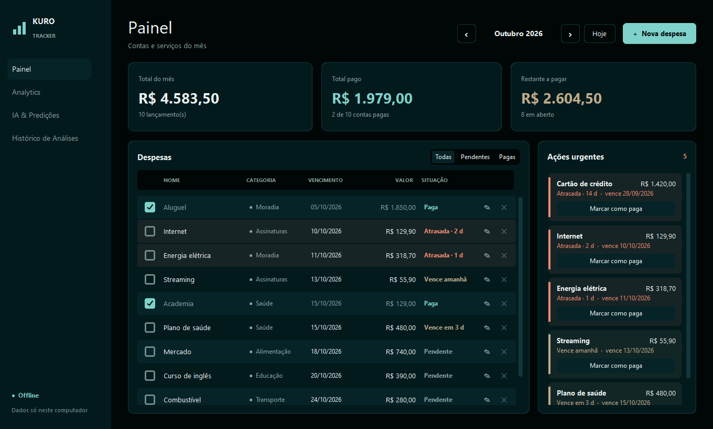
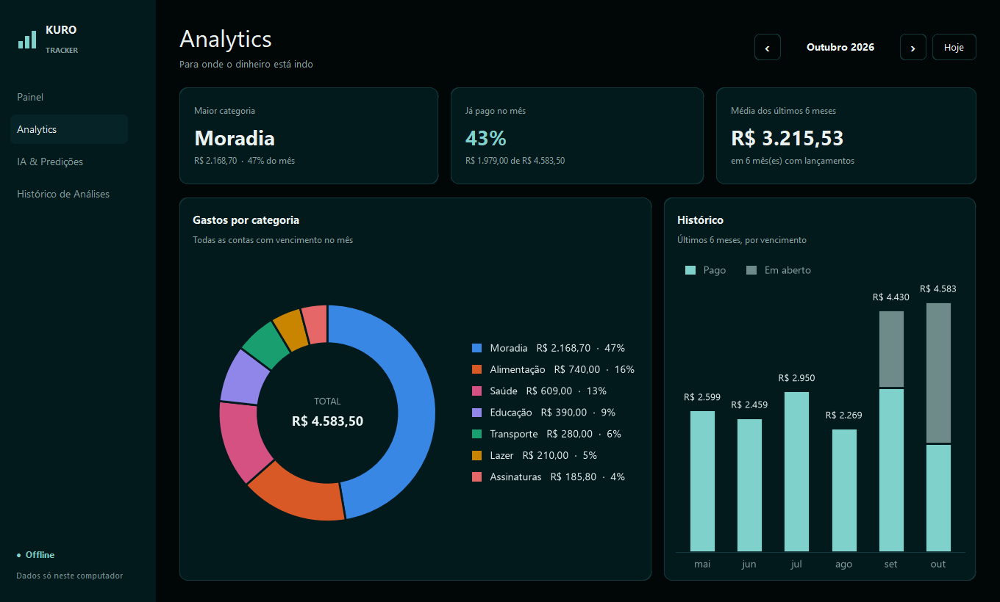
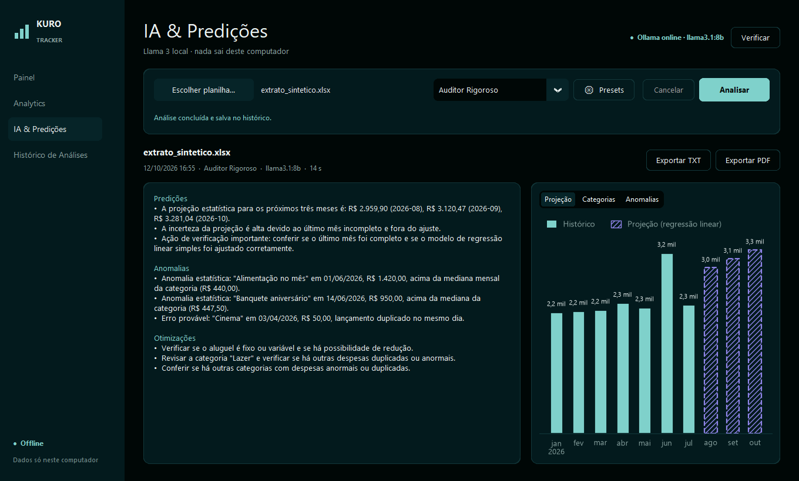
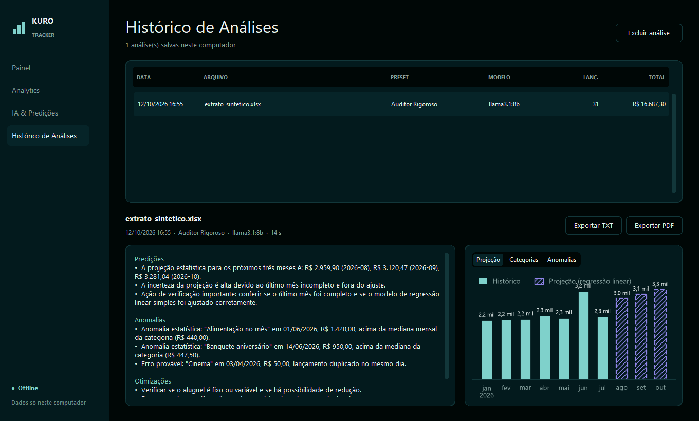
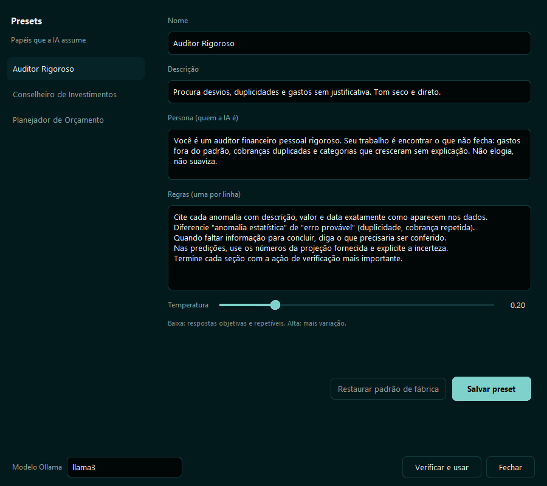
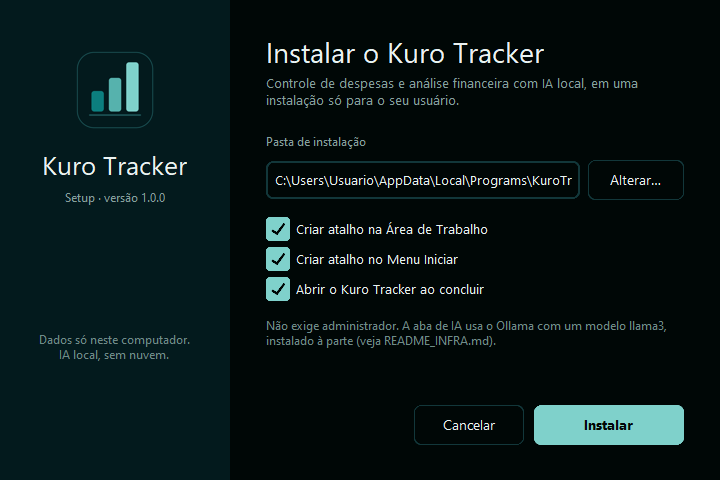
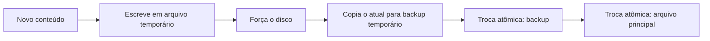
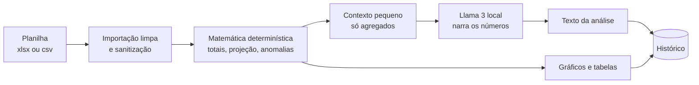
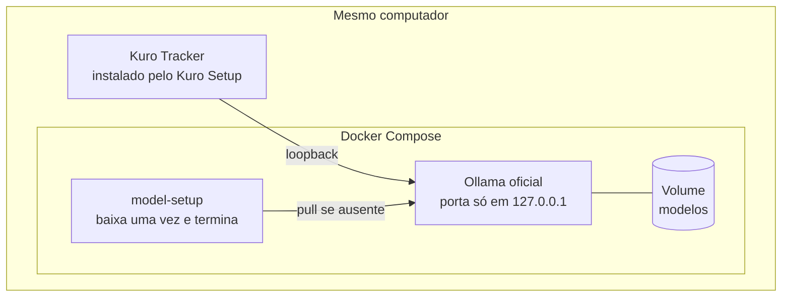
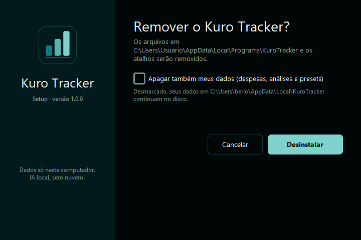

# Kuro Tracker: Desktop B2B com Zero-Data Egress e Edge AI

> **Projeto pessoal.** Feito por mim, sozinho, para estudar e demonstrar decisões de engenharia. Não tem clientes, não é produto comercial e o código-fonte é privado. Tudo o que está aqui foi executado e medido na minha máquina (Windows 10, Python 3.13) em outubro de 2026; o que não foi provado está na seção 9.

**Gabriel Berlofa** · Engenharia de Software · Edge AI, Python, arquitetura de dados

---

## Resumo em uma tela

- **Problema:** controlar contas e entender para onde o dinheiro vai, sem entregar o extrato a um serviço na nuvem.
- **Solução:** aplicativo desktop para Windows que guarda tudo em arquivos locais e usa um Llama 3 rodando na própria máquina para comentar uma planilha de gastos.
- **Diferencial de engenharia:** o **código calcula e o modelo narra**. Totais, projeção e anomalias são matemática determinística testada; o LLM recebe os números prontos. Os gráficos nunca vêm do texto do modelo.
- **Privacidade como propriedade testada:** o cliente de IA só aceita loopback, ignora proxy de ambiente e não segue redirecionamento. Há teste para cada caso, contra um servidor HTTP real na máquina.
- **Persistência que sobrevive a uma queda:** escrita atômica com backup, validação registro a registro e quarentena de arquivo ruim.
- **Entrega:** instalador próprio em Python e Docker Compose para a infraestrutura de IA. A abertura caiu de cerca de 9 s para cerca de 1 s ao trocar o modo de empacotamento.

---

## Telas

| | |
|---|---|
|  |  |
| **Painel:** contas do mês, ações urgentes e totalizadores | **Analytics:** categorias e histórico de seis meses |
|  |  |
| **IA & Predições:** texto do Llama 3 local e gráficos calculados | **Histórico:** cada análise reabre com texto e gráficos |
|  |  |
| **Presets:** papéis da IA editáveis na própria interface | **Kuro Setup:** instalador próprio, por usuário, sem administrador |

_Todas as capturas usam dados sintéticos._

---

## 1. O problema (e a restrição que moldou tudo)

Duas dores pequenas e reais para uma pessoa só: saber o que está atrasado ou vence nos próximos dias, e entender um extrato em planilha que ninguém analisa. As ferramentas de IA na nuvem resolveriam a segunda, mas exigem enviar o extrato para fora.

A restrição que decidiu o resto: **um usuário, um computador, nenhum dado sai da máquina.** Isso elimina servidor, login e sincronização e puxa as escolhas para o lado simples. Também significa que a privacidade precisa ser uma propriedade do sistema, não uma frase no README.

---

## 2. A filosofia de UI/UX: do Tailwind/React ao CustomTkinter

O Kuro Tracker herda a identidade visual do **Kuro Pricing**, que é um app web em React com Tailwind. A pergunta de design foi: dá para manter a mesma linguagem B2B premium numa interface desktop em Python, sem abandonar o rigor?

A resposta foi tratar o `@theme` do Tailwind como **fonte de tokens**: cada cor, raio e espaçamento do projeto web virou uma constante nomeada no app desktop, e as telas só consomem os nomes.

### A paleta: Ink, Mint e Coral

| Token | Hex | Papel |
|---|---|---|
| **Ink** | `#000706` | Fundo da página; o preto-petróleo |
| Panel / Panel-2 | `#031a1d` / `#062428` | Cards, barra lateral e linhas alternadas |
| Line / Line-strong | `#12373a` / `#1d5558` | Bordas de 1 px de baixo contraste |
| **Mint** | `#7fd1cb` | **A única cor de ação**: botões primários, seleção, "pago" |
| **Coral** | `#f08a72` | Estado crítico: conta atrasada, ação destrutiva |
| Sand | `#bfac8b` | Estado de alerta: vence em até 3 dias |
| Fg / Fg-soft / Fg-mute | `#eaf2f1` / `#b1c4c2` / `#86a09e` | Texto primário, secundário e de apoio |

Regras que vieram junto:

- **Uma cor de ação.** Quem olha a tela sabe onde clicar; Mint é a única cor "de botão".
- **Cores de estado só em dado, nunca em decoração.** Coral e Sand só aparecem quando há uma conta atrasada ou prestes a vencer.
- **Texto sobre Mint usa Ink**, porque Mint é clara.

### Geometria: classes do Tailwind viram constantes

| No Tailwind | No CustomTkinter |
|---|---|
| `rounded-xl` (cards) | raio 12 |
| `rounded-lg` (botões, campos) | raio 8 |
| `h-10` | altura de controle 40 |
| `p-5` | respiro interno de card 20 |
| `gap-4` | espaço entre cards 16 |
| `p-8` | margem da página 32 |

### Tipografia

Os títulos usam uma fonte serifada de display e o resto usa uma sans, ambas derivadas de fontes abertas (SIL OFL). Foram geradas versões estáticas com **dígitos tabulares embutidos**, porque o Tk não aplica recursos OpenType: sem isso, os valores em reais não alinhariam em coluna. É o equivalente desktop do `tabular-nums` do Tailwind.

### Acessibilidade e verificação

- **Contraste de texto verificado por teste** (WCAG AA): se alguém mexer na paleta e quebrar o contraste, a suíte falha.
- **Paleta de gráficos validada por ferramenta**, não de memória. A primeira ordem de cores que usei **não passou** (duas séries ficavam indistinguíveis para daltonismo); foi corrigida para uma ordem que passa.

---

## 3. Arquitetura de dados: persistência que sobrevive a uma queda de energia

### Escrita atômica (Atomic Writes)

Os dados ficam em arquivos legíveis. Para isso ser seguro, **toda** gravação segue o mesmo caminho, inclusive a do backup:

Se a energia cair em qualquer ponto, sobra o arquivo antigo inteiro ou o novo inteiro, nunca metade. Na leitura:

- **registro inválido** é ignorado e o arquivo original é copiado ao lado como evidência, com aviso na tela;
- **arquivo ilegível** restaura o último backup e preserva o corrompido;
- **nada é sobrescrito em silêncio.**

Dois detalhes que só apareceram por revisão adversarial:

1. A cópia do backup originalmente não era atômica; um corte no meio deixava o backup pela metade.
2. O estado em memória só muda **depois** de o disco aceitar a gravação. Antes, uma falha de escrita deixava a tela mostrando algo que não estava salvo.

### Dinheiro em centavos inteiros

Nenhum valor monetário passa por `float`. A conversão acontece **só nas bordas** (entrada do usuário e exibição):

| Na tela | No arquivo e na memória |
|---|---|
| `R$ 1.234,56` | `123456` (inteiro, em centavos) |
| `R$ 0,05` | `5` |

Isso torna as somas exatas e os testes triviais. A entrada aceita os formatos brasileiros e internacionais de número, e valores negativos de extrato bancário são tratados na importação, nunca no cálculo.

### O histórico guarda o estado completo da análise

Cada análise é salva com o texto da IA, o papel usado, o modelo **e todos os dados dos gráficos**. Reabrir uma análise antiga reconstrói exatamente o que foi mostrado, sem recalcular nem reconsultar o modelo.

---

## 4. O cérebro: matemática determinística primeiro, IA só narra

### A divisão de responsabilidades

| Responsabilidade | Quem faz | Por quê |
|---|---|---|
| Totais por mês e categoria | Código | Soma exata e testada |
| Projeção dos próximos meses | Código (regressão linear simples) | Determinística; não finjo sazonalidade que não consigo estimar |
| Anomalias e duplicidades | Código (estatística robusta a valores extremos) | Um gasto absurdo não infla o próprio critério de "absurdo" |
| Gráficos e tabelas exportadas | Código, do mesmo objeto calculado | O gráfico mostra o que foi calculado, nunca o que o modelo "lembrou" |
| Texto: predições, anomalias, sugestões | Llama 3 local | Linguagem é o ponto forte do modelo; os números já chegam prontos |

### O que o modelo recebe

- **Um contexto pequeno e limpo:** só agregados e poucas linhas, com e-mails e sequências longas de dígitos mascarados.
- **Dentro de um bloco que o prompt manda tratar como dado**, nunca como instrução. Isso reduz a superfície de *prompt injection* vinda de células de planilha.
- **Um contrato fixo** (idioma, formato em três seções, "use somente os números fornecidos") que o usuário não consegue editar. O papel do modelo (um "Auditor Rigoroso", um "Conselheiro de Investimentos") é um preset editável na interface.

### Zero-Data Egress, provado por teste

O cliente da IA local foi desenhado para **recusar**, antes de abrir qualquer conexão:

- qualquer endereço que não seja loopback;
- proxy configurado no ambiente (que poderia desviar até o `localhost`);
- redirecionamento HTTP (que levaria a requisição para outro host);
- credenciais na URL usadas para esconder um endereço externo;
- resolução de nome: o `localhost` é fixado no endereço IP.

Os testes sobem um **servidor HTTP real** na máquina imitando o Ollama: streaming, erro no meio do fluxo, resposta truncada, cancelamento e redirecionamento para um segundo servidor que conta acessos. Duas decisões menos óbvias: **o app nunca baixa modelos sozinho** e **resposta truncada nunca é sucesso**: cancelar ou falhar não grava nada no histórico.

### Portabilidade: a IA como infraestrutura à parte (Docker Compose)

O aplicativo é pequeno e funciona sem IA. O modelo não: são ~5 GB e uma licença própria. Embutir isso no instalador significaria um download enorme e redistribuir pesos. A decisão foi **separar**:

- um serviço de setup espera o servidor ficar saudável e baixa o modelo **uma única vez**; reexecutar o compose não baixa de novo;
- a porta é publicada **somente em loopback**, porque o Ollama não tem autenticação;
- o app localiza o modelo **pela família**, então uma máquina com outro modelo compatível funciona sem recompilar;
- depois do download, tudo funciona sem internet. Quem não quer Docker instala o Ollama nativo.

> **Honestidade:** este compose **ainda não foi executado**. A máquina em que desenvolvi não tem Docker, então a estrutura é conferida por testes, não o comportamento. O primeiro `docker compose up -d` real é o teste que falta.

---

## 5. DevOps e performance

### O salto de abertura: de ~9 s para ~1 s

O PyInstaller em modo `onefile` extrai todo o pacote para uma pasta temporária **a cada abertura**. Medi em vez de supor:

| Estratégia | Tempo até a janela principal |
|---|---|
| `onefile` (ponto de partida) | 8,9 a 9,6 s |
| `onefile` + tela de abertura + telas pesadas sob demanda + pacote enxuto | 6,5 a 7,0 s (a tela de abertura aparece em ~0,65 s) |
| **`onedir` instalado** | **0,9 a 1,7 s** |

A tela de abertura melhorava a **percepção**, mas o tempo real continuava alto: a causa era a extração. O `onedir` não extrai nada, então virou o padrão. Pelo caminho, o pacote perdeu cerca de 13 MiB porque uma dependência pesada entrava só por efeito colateral de outra, e as telas de IA passaram a ser criadas na primeira visita.

### O instalador próprio (Kuro Setup)

O `onedir` resolveu a performance, mas uma pasta não é algo que se entrega. Eu queria um único `KuroTracker_Setup.exe` com a identidade visual do app. A ferramenta clássica para isso **não estava instalada** na máquina; em vez de escrever um script que eu não pudesse executar, fiz um instalador em Python que eu consigo testar de verdade.

| Capacidade | Como |
|---|---|
| Extração segura | Recusa entradas que escrevem fora da pasta de destino (*zip-slip*) e pacotes com tamanho ou quantidade de arquivos absurdos (*zip-bomb*) |
| Troca sem risco | Instala numa pasta de preparação e troca; se falhar no meio, volta a instalação anterior |
| Integração com o Windows | Atalhos na Área de Trabalho e no Menu Iniciar, registro em *Aplicativos e recursos*, instalação por usuário sem administrador |
| Desinstalação segura | Roda de uma cópia temporária; **só apaga uma pasta que pareça a instalação**; os dados do usuário são mantidos por padrão |
| Automação | Modo silencioso com relatório em arquivo |

O processo de geração do instalador só termina com sucesso depois de **instalar, rodar o autoteste do aplicativo instalado e desinstalar** numa pasta temporária. Esse teste real encontrou dois bugs meus: um impasse no desinstalador silencioso e um caso em que a limpeza apagaria a pasta do Python em desenvolvimento. Ambos corrigidos, com teste.

### O executável se auto-verifica

O aplicativo empacotado tem um modo de autoteste que roda **dentro do executável** e confere o que o empacotador costuma esquecer: dados embutidos, fontes, leitura de planilha, geração de PDF, a trava de loopback e os gráficos. O build aborta se qualquer item falhar.

---

## 6. Resultados medidos

| Medida | Valor | Condição |
|---|---|---|
| Testes automatizados | **210** | Regras, persistência, serviços, instalador e infraestrutura; servidor HTTP real em localhost |
| Pipeline de 20 mil lançamentos (CSV → análise → contexto) | **0,29 s** | Dados sintéticos, máquina de desenvolvimento |
| Análise real com `llama3.1:8b` local | 14,6 s (9,3 s até o primeiro token, modelo frio); 5 s em outra execução | Planilha sintética de 38 lançamentos |
| Abertura do `onefile` (ponto de partida) | 8,9 a 9,6 s | Extração a cada abertura |
| Abertura do `onedir` instalado | 0,9 a 1,7 s | A primeira execução do dia foi a mais lenta |
| Tamanho do `onefile` | 51,1 → 38,2 MiB | Depois de remover uma dependência sem uso |
| Instalador | 75,3 MiB | Instala e desinstala de verdade em teste automatizado |

---

## 7. A decisão de empacotamento em uma frase

Medi antes de decidir: a tela de abertura resolvia a **percepção** de lentidão, o `onedir` resolveu o **tempo real**. Quando as duas coisas competem, escolho a que muda o número.

---

## 8. Por que isso é B2B (e por que não é)

Os critérios de engenharia são os de um produto B2B: dado que não sai do cliente, instalação por usuário sem administrador, atualização que não deixa instalação pela metade, desinstalação que preserva os dados, falha explicada em vez de silenciosa. **Mas não é um produto B2B**: não tem clientes, nem suporte, nem multiusuário. É um exercício deliberado de aplicar esse rigor a um problema pequeno.

---

## 9. O que NÃO está provado

- **Qualidade do texto do modelo.** Rodei o Llama 3.1 8B em poucas planilhas sintéticas. Numa delas ele escreveu um termo estatístico que não existe nos dados. Não há avaliação sistemática.
- **Fidelidade numérica do texto.** Não há verificação automática de que os valores citados pelo modelo estão no contexto que ele recebeu.
- **A projeção é simples:** regressão linear, sem sazonalidade e sem intervalo de confiança.
- **Docker e outras máquinas.** O compose nunca foi executado, e o instalador nunca rodou numa máquina limpa. Nenhum executável é assinado, então o SmartScreen pode avisar.
- **Usabilidade.** Ninguém além de mim usou. Não houve auditoria de acessibilidade por teclado ou leitor de tela.
- **Concorrência.** Não há trava entre processos: duas janelas abertas gravam por cima uma da outra.
- **Fontes nos gráficos.** O motor de gráficos recusou as fontes estáticas da marca; os gráficos usam outra fonte que a da interface.

---

## 10. Erros que cometi (e o que o processo revelou)

1. **Dei como "validada" uma paleta que não estava.** Rodar o validador contradisse a minha memória.
2. **Cancelar uma geração devolvia texto parcial como sucesso.** Fechar a conexão fazia o laço terminar sem erro.
3. **O detector de anomalias não via o óbvio** numa categoria que misturava compras pequenas e grandes. Acrescentei uma segunda regra, por mês da categoria.
4. **Furos na minha própria promessa.** Ao escrever perguntas difíceis de um *tech lead* para estudo, achei que a cópia do backup não era atômica e que o cliente HTTP seguia redirecionamentos. As duas coisas contradiziam o que eu afirmava; corrigi e testei.
5. **Uma limpeza que atingiria o diretório do Python.** Só apareceu porque testei o desinstalador de verdade, não só a lógica.
6. **Uma tecnologia citada em perfil público sem ter sido usada em nenhum projeto.** A auditoria contra o código a achou e ela saiu.

A lição que mais repito: escrever as perguntas difíceis e testar o artefato final encontra mais do que reler o código.

---

## 11. O que eu faria diferente

- Migrar para SQLite assim que houver escrita concorrente, histórico grande ou consulta por período (a camada de persistência já isola a troca).
- Verificar automaticamente a fidelidade numérica do texto do modelo.
- Trava de instância única e testes automatizados de interface (hoje a UI é verificada por captura de tela).
- Assinar o executável e o instalador antes de entregar a outra pessoa.
- Executar o Docker Compose e o instalador em uma máquina limpa.

---

## Ficha técnica

| | |
|---|---|
| **Tipo** | **Projeto pessoal** (estudo e portfólio); código-fonte em repositório privado |
| **Plataforma** | Windows 10, Python 3.13 |
| **Interface** | CustomTkinter, Matplotlib; identidade herdada do Kuro Pricing |
| **IA** | Ollama em loopback, modelo da família Llama 3 (testado com `llama3.1:8b`) |
| **Dados** | Arquivos JSON locais com escrita atômica; presets em YAML; entrada `.xlsx` e `.csv`; saída TXT e PDF |
| **Entrega** | PyInstaller `onedir`, instalador próprio em Python, Docker Compose para o Ollama |
| **Testes** | 210 automatizados |
| **Tamanho do código** | ~8,3 mil linhas de Python, incluindo ~1,7 mil de testes (medido) |
| **Contato** | [LinkedIn](https://www.linkedin.com/in/gabriel-berlofa-b65a31431/) · [Portfólio](https://gabriel-nux.github.io/) · [GitHub](https://github.com/Gabriel-nux) |
